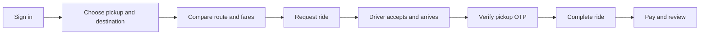

# Zoomo

<p align="center"></p>

> **Ride booking for riders + drivers.** Search pickup. Compare route fares. Book. Track. Pay. Review.

Early-stage SaaS MVP: responsive web app, role-aware API, PostgreSQL, maps, Stripe Checkout. Core ride lifecycle works. Public launch needs stronger ops, support, and service controls.

## Product

### Rider experience

- Sign up or sign in as rider.
- Search address or choose map point; request route estimate.
- Compare bike, auto, cab, maxi-cab fares.
- Track driver; share pickup OTP; cancel eligible ride; view history.
- Pay completed ride via Stripe Checkout; rate driver. Search/filter ride history; rebook past routes with refreshed fares.
- Persistent sign-in until logout. Old Cabby browser session migrates to Zoomo storage.

### Driver experience

- Register vehicle + ride category.
- Toggle availability; receive matching requests; update ride status.
- Share device location; verify rider pickup OTP; see ratings.

### Platform behavior

- FastAPI enforces roles + ride-state transitions.
- API calculates route fares server-side.
- Stripe webhook checks signature, ride, amount, INR currency before paid status.
- Supabase PostgreSQL in production; SQLite local.
- Signed bearer session + small profile cache in browser; server revokes session at logout.
- Login screen opens directly; no blocking account-check splash.

## Ride lifecycle



Animation honors `prefers-reduced-motion`.

## Architecture

| Layer | Technology | Location |
| --- | --- | --- |
| Web app | Next.js App Router, React, TypeScript | `frontend/` |
| Map UI | Leaflet with OpenStreetMap tiles | `frontend/app/components/` |
| API | FastAPI, SQLAlchemy, Pydantic | `backend/main.py` |
| Database | Supabase PostgreSQL or local SQLite | `supabase/migrations/` |
| Routing and geocoding | OSRM, Photon, Nominatim | Configurable backend endpoints |
| Checkout | Stripe Checkout and signed webhooks | `backend/main.py` |
| Web hosting | Vercel | `frontend/` |
| API hosting | Render Blueprint | `render.yaml` |

```text
Browser ── HTTPS ──> Next.js on Vercel
   │                       │
   │ bearer session        │ NEXT_PUBLIC_API_URL
   └───────────────────────┴──> FastAPI on Render ──> Supabase PostgreSQL
                                      ├── OSRM / Photon / Nominatim
                                      └── Stripe Checkout + webhook
```

## Repository map

```text
backend/                 FastAPI app, env examples, API integration tests
frontend/                Next.js app, map components, browser session cache
supabase/migrations/     Ordered SQL migrations for production data
docs/assets/             Animated ride flow for README
logos/                   Supplied static + animated Zoomo logos
render.yaml              Render API service blueprint
```

## Run locally

### Requirements

- Python 3.11 or newer
- Node.js 20 or newer
- npm
- Optional: Supabase and Stripe test-mode accounts for hosted database and checkout flows

### 1. Start the API

```bash
cd backend
python -m venv .venv
source .venv/bin/activate            # Windows: .venv\Scripts\activate
pip install -r requirements.txt
cp .env.example .env
uvicorn main:app --reload
```

Local API defaults to `zoomo.db`. Leave `SUPABASE_DATABASE_URL` empty for SQLite. Startup creates SQLAlchemy tables + default ride modes.

### 2. Start the web app

In a second terminal:

```bash
cd frontend
cp .env.local.example .env.local
npm ci
npm run dev
```

Open [localhost:3000](http://localhost:3000). API docs: [localhost:8000/docs](http://localhost:8000/docs). Health: [localhost:8000/api/health](http://localhost:8000/api/health).

### Environment configuration

| Variable | Service | Required | Description |
| --- | --- | --- | --- |
| `DATABASE_URL` | API | Local default | SQLite connection string; defaults to `sqlite:///./zoomo.db`. |
| `SUPABASE_DATABASE_URL` | API | Production | Supabase Session pooler PostgreSQL URL. Takes precedence over `DATABASE_URL`. |
| `TOKEN_SECRET` | API | Yes outside local development | Long random signing key. Changing it invalidates existing signed tokens. |
| `CORS_ORIGINS` | API | Production | Comma-separated exact browser origins, without trailing slashes. |
| `FRONTEND_URL` | API | Production | Public web origin used to build Stripe return URLs. |
| `MAPS_USER_AGENT` | API | Recommended | Contactable identifier for public geocoding requests. |
| `STRIPE_SECRET_KEY` | API | For card checkout | Stripe test or live secret key. Checkout is unavailable when missing. |
| `STRIPE_WEBHOOK_SECRET` | API | For card checkout | Signing secret for the deployed Stripe webhook. |
| `NEXT_PUBLIC_API_URL` | Web build | Production | Public API origin, for example `https://zoomo-api.onrender.com`; no `/api` suffix. |

`NEXT_PUBLIC_API_URL` is build-time config. Set in Vercel before build; redeploy after changes.

## Database and deployment

### Supabase

New production DB: apply every `supabase/migrations/` SQL file in filename order via Supabase SQL Editor. Use Session pooler URL for `SUPABASE_DATABASE_URL`; keep credentials on API server. FastAPI enforces authorization; RLS does not replace API checks.

API creates `auth_sessions` at startup. Keep app schema + SQL migrations aligned for future DB changes.

### Render API

Create/update Blueprint from `render.yaml`. Set:

- `SUPABASE_DATABASE_URL`
- `TOKEN_SECRET` (Render generates a value in the Blueprint)
- `CORS_ORIGINS` and `FRONTEND_URL` with the deployed Vercel origin
- `MAPS_USER_AGENT` with a real contact address
- `STRIPE_SECRET_KEY` and `STRIPE_WEBHOOK_SECRET` for payments

Blueprint service name: `zoomo-api`. Blueprint rename does not rename existing Render service/host. Set `NEXT_PUBLIC_API_URL` to actual API origin.

### Vercel web app

1. Import repo.
2. Set **Root Directory** = `frontend`.
3. Set `NEXT_PUBLIC_API_URL` = public API origin.
4. Deploy; check `/` + `/payment`.

Repo rename does not change Vercel project slug/domain. Rename those in Vercel if desired.

### Stripe

Start in Stripe test mode. Set `FRONTEND_URL`; configure webhook `https://<api-host>/api/webhooks/stripe`. Subscribe to `checkout.session.completed`, `.async_payment_succeeded`, `.expired`; `payment_intent.succeeded` also supported. Signed webhook owns paid status; browser return URL does not.

## Quality checks

Install backend test dependencies and run the API suite:

```bash
python -m pip install -r backend/requirements-dev.txt
PYTHONPATH=backend pytest -q -s backend/tests
```

Suite uses isolated SQLite + local mock route provider. Covers rider/driver auth, persistent session revocation, fares, booking, assignment, OTP, cancel, review authorization, payment config guards, invalid Stripe signatures. Load case sends 1,000 health requests at 50 concurrent clients; prints throughput + latency percentiles.

Run frontend checks:

```bash
cd frontend
npm ci
npm run lint
npm run build
```

### Latest local verification

| Check | Result |
| --- | --- |
| API feature/integration suite | **6 passed** |
| Parallel API load | **1,000 requests**, 50 concurrent clients, 0 failures |
| Local API throughput | **1,052.6 requests/second** in the recorded run |
| API latency | **p50 29.7 ms · p95 63.8 ms · p99 82.8 ms** |
| ESLint | **Passed with no warnings** |
| Next.js production build | **Passed**; `/`, `/payment`, and `/_not-found` prerendered |
| Browser feature/usability audit | **Passed**; immediate login, session restore/migration, logout, mobile layout |
| axe accessibility audit | **0 violations** across login, registration, desktop dashboard, mobile dashboard |

Browser audit: Chromium; axe passed 29–36 rules per screen; 0 violations across 4 screens. 375px viewport had no horizontal overflow. Load stats: local developer environment, API health endpoint. Regression signal only; not production capacity or end-to-end booking benchmark. External routing, hosted Postgres, Stripe, deployed services excluded.

## Security and operating notes

- Passwords: salted PBKDF2 hashes; never cached raw.
- Signed bearer token in `localStorage`; server session revoked at logout. XSS can expose token. Before higher-risk launch, add strict CSP + secure HTTP-only cookies.
- Tokens lack time expiry; logout or `TOKEN_SECRET` rotation revokes. Add idle + absolute expiry before broad launch.
- Stripe/DB secrets stay server-side. Only `NEXT_PUBLIC_*` enters frontend build.
- Location permission requested when needed; address search works if denied.
- Public OSRM, Photon, Nominatim, OSM tiles have usage limits + no uptime guarantee. Contract providers before scale.
- Tests use loopback + mocked routes; no real booking/payment.

## Product gaps before general availability

Before public onboarding: identity/vehicle verification, account recovery, email/SMS, support/disputes/refunds, abuse controls + rate limits, audit trails, backups + restore drills, monitoring/alerts, retention controls, production-like DB load tests, formal security + accessibility review. No subscription billing or multi-tenant operator console today.

## Rebrand notes

App, API, package, deploy template, local DB defaults, docs use **Zoomo**. `cabby_token` + `cabby_user` migrate to Zoomo keys; users stay signed in. Rename existing Render/Vercel project, host, domain in provider dashboards separately.
